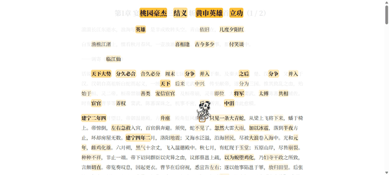

# 啃读点书吗？ — Chrome 扩展（MV3）v1.0.0

中文阅读重点标注 + 跟读节奏模式，帮 ADHD 人群专注阅读。斑点狗陪读，阅读时长换狗狗币解锁品种。

> 📖 **产品说明（思路 + 功能全景）见 [`PRODUCT.md`](PRODUCT.md)**
>
> 🎬 **演示**（跟读模式：小狗匀速扫读、高亮词幸存跳过）：



**完整演示视频**（含安装到高亮/跟读/校准操作）：

<video src="演示视频.mp4" controls width="720" poster="assets/demo.gif"></video>

**灵感来源**：本项目受到小红书用户 **@好的夏洛特** 与 **@无用的好奇** 关于阅读专注/重点标注分享的启发，特此致谢。

设计文档（算法/架构/经济系统）：`D:\Documents\Obsidian Vault\啃读点书工程\啃读点书吗·设计文档.md`

## 安装（加载到浏览器）

### 方式一：加载已解压的扩展（开发/使用）

1. 下载/拷贝本项目到本地（如 `C:\Users\<你的用户名>\Desktop\kddsm？`）
2. 打开 Chrome（或 Edge / 360 极速等 Chromium 内核浏览器），地址栏输入 `chrome://extensions`
3. 打开右上角「**开发者模式**」开关
4. 点击「**加载已解压的扩展程序**」→ 选择项目目录（含 `manifest.json` 的那一层）
5. 完成：工具栏出现斑点狗小狗图标，打开任意中文网页自动高亮

> 本地 `file://` 网页需要额外一步：扩展卡片 → 「详情」→ 开启「**允许访问文件网址**」。

### 方式二：安装打包好的 `.zip`（推荐分发）

1. 下载发布包（见 GitHub Releases / 打包说明）
2. 解压到固定目录（**解压后不要移动**，Chrome 按目录引用）
3. 重复方式一的 2–5 步，选择解压后的目录

### 验证是否安装成功

- 扩展详情页显示版本 **1.0.0**
- 打开任意中文文章页（如 https://quanben5.com 的小说章节）→ 页面自动出现琥珀色高亮
- 点工具栏小狗图标 → popup 切「跟读」→ 小狗出现并逐字扫读

## 使用

| 操作 | 效果 |
|---|---|
| 点击工具栏「啃读点书吗？」图标 | 打开 popup |
| popup 点「开启高亮」/ Alt+Z | 当前页一键重点标注（默认关） |
| 切「跟读模式」+ 调速滑杆 | 斑点狗逐字推进，吃过的字淡出（不删除）；popup 可切「完全隐藏」 |
| popup 跟读按钮 | 暂停 / 继续 / 重读；切到别的标签页自动暂停；读完页内提示「读完啦 🦴 点这里重读」 |
| 点击任意高亮词 | 跟读跳回该词重读 |
| popup「AI 校准」 | 把本页正文发给接口，让模型标出真正重要的信息点（同一页面只发一次，之后走本地缓存） |
| 阅读计时 | 活动阅读 1 分钟 = 1 🦴 狗狗币，日上限 60（前台 + 有推进/滚动信号才算） |
| 狗舍 | 初始斑点狗，100 🦴 解锁任意品种 |

## v1.0 更新

**体验权限收回**
- 「体验模式：全部狗狗开放」的开关从界面移除，代码里保留一条内部口令通道（写在 `popup.js` 的 `UNLOCK_CODE`，**不出现在任何 UI 文案里**）。体验状态单独存在 `kdTrial`，不再复用 `kdDogs.devAll`，所以老版本留下的「全解锁」也会一并失效，回到正常的攒币解锁流程。
- 新装默认只送 1 只初始犬，其余 14 只 100 🦴 解锁。

**动图重做（15 个品种全部换新）**
- 老素材的三个硬伤：帧底被裁（狗没有腿）、每帧独立缩放到填满方框（跑起来大小抖动像在呼吸）、个别品种串帧（罗威纳里混进了花狗帧）。
- 现在用 ImageGen 以各品种肖像为角色参考，逐品种生成「同一只狗的连续奔跑帧」，再由 `tools/gen_run_cycle.py` 处理：去底 → 连通域切帧（不再水平等分，能容忍贴帧/两行排布）→ 按高度统一标尺 + 脚底基线对齐 → 输出 128px/帧（2x）。原始生成图留在 `assets/dogs-ai/sheets/{breed}_sheet.png`（`index.json` 是品种→文件索引），重做全部素材只要一条命令：`python tools/gen_run_cycle.py`（也可只跑指定品种：`... corgi husky`）。
- 帧数不再写死 6：`--kd-frames` 由图片宽高比推出来，CSS 的 `steps()`/背景位移跟着变；跳跃复用奔跑帧（上抛由 CSS 弧线负责），省掉一份重复图。
- 狗的渲染补了地面投影，跳跃加了轻微旋转，`prefers-reduced-motion` 仍然全关。

**popup 视觉重做**
- 奶油底 + 更轻的边线/阴影、状态圆点（未启用/已高亮/跟读中）、币数改成胶囊、狗舍卡片加上锁角标与按压反馈、折叠面板标题带开关徽标、跟随系统深色模式。

**这一轮修掉的 bug**（都是能复现的）
1. **签到 / 日上限按 UTC 算**：`toISOString()` 是 UTC，北京时间每天 08:00 前会被算成前一天 → 签到可重复、日上限错位。改为本地日期（popup + content 各一处）。
2. **日上限可被绕过**：到 60 币后 `activeSec` 仍在累加，挂机攒一整天，第二天开页瞬间刷满 60。现在封顶 59。
3. **SPA 重分析后 BERT 层永久丢失**：Worker 的 `ready` 只发一次，页面重分析后再没人要分数 → 后续高亮只剩静态分。现在重分析结束会按需重新请求。
4. **关掉高亮后迟到的模型分数会把高亮写回页面**：`onModelScores` 少了 enabled 判断。
5. **移除体验开关会连带炸掉整个 popup**：模块级 `getElementById(...).addEventListener` 一旦取到 null 就抛错，后面所有绑定都不执行。全部改成带守卫的 `on()`。
6. **透明度输入被清空 → 高亮全透明**（`+'' === 0`）；非法色值会把 `NaN` 写进样式。
7. **长文点击回看卡顿**：`findIndex + includes` 是 O(词数×片段数)，改成 span→token 的 Map；`segmentsForRange` 也改成二分定位起点节点（原来每个 token 都从第一个文本节点扫）。
8. 速度滑杆每移动 1px 就写一次 storage + 发一次消息 → 120ms 防抖。
9. 1.5s 轮询没有并发保护，页面卡住时消息堆积 → 加 in-flight 锁。
10. 跳跃回落的定时器闭包用了旧品种（切狗后会被拽回旧品种），且定时器会堆积 → 改用当前品种 + 单定时器。
11. 新装首次打开时 15 张狗卡全显示成"上锁"灰态（其实都能免费选）。
12. 未知消息类型不回包 → 发信方端口超时并刷控制台错误。
13. `initChoiceDone` 只看 `kdDogs` 是否存在：`owned` 为空时会跳过初始引导，导致一只狗都没有。

## 安全与隐私

- **无任何遥测/统计外联**：代码中唯一的网络请求是（1）加载扩展自带的词典/模型（本地资源）与（2）**AI 校准**时向你在配置里填写的接口发送正文——没有埋点、没有统计、没有任何其他外发。
- **AI 校准有隐私闸门**：含密码框的页面、本地 `file://`、内网地址、`.local` 域名**默认跳过上传**；同一页面 7 天内走本地缓存不重复请求；正文截断上限约 1.2 万字。
- **本地优先**：分词词典、打分模型（tiny BERT，int8 ONNX）全部随扩展打包，在浏览器内运行，**文本不出浏览器**（关闭 AI 校准后完全零外发）。
- **无注入面**：高亮包裹全部用 `createElement` + `textContent` 构造，无用户输入进入 `innerHTML`；MV3 默认 CSP 禁止内联脚本。
- **最小权限**：manifest 仅申请 `activeTab` + `storage`（+ 为剥离 Origin 调 B站接口所需的 `declarativeNetRequest`），无 `webRequest`、无 `cookies`、无浏览历史访问。
- **数据全部本地**：狗狗币、解锁记录、阅读进度、校准缓存都存在浏览器本地 `chrome.storage.local`，无云端账号。
- **说明**：若在配置里填写 API Key（用于自定义接口），Key 以明文存在本地扩展存储中——与浏览器保存密码同级别的本地保护，不会上传。

## 当前状态（v0.9）

- ✅ **跟读体验**：速度选择持久化（1–80 cps）；**暂停/继续/重读**；切后台自动暂停；读完页内 toast 一键重读；已读默认**淡出保留**（`--kd-eaten-op`，popup 可切「完全隐藏已读文字」）
- ✅ **跟读性能**：`markPace` 改为增量（只处理跨过的区间）+ token 二分定位 `tokenIndexAt()`；原实现每 100ms 全量遍历所有 token×span，长文会明显掉帧
- ✅ **滚动跟随修复**：正文在可滚动 `div` 内时也能跟随（`scrollableAncestor()`/`ensureVisible()`），不再只依赖 `window.scrollBy`；隐藏节点不再把狗甩到左上角
- ✅ **AI 校准重写**：`llmState`（idle/running/ok/fail/skip/off）状态机 + 世代作废（关掉后迟到结果不写回）+ 2 次预算 + 20s 超时 + 只对可恢复错误（超时/网络/5xx/429）退避重试一次、空结果换短输入重试一次
- ✅ **AI 加成算法**：按 token 去重、单次 ×2.2（原来是按出现次数连乘 1.8，常见词直接霸榜）；`_preLlm` 快照支持「关 AI 无损回退」；短语去重 + 上限 24
- ✅ **AI 缓存 + 隐私闸门**：`kdLlmCache`（TTL 7 天，最多 20 条）→ 同 URL 二次校准零请求，SPA 重分析后本地自动补回；含密码框 / 非 http(s) / localhost·内网·`.local` 默认跳过上传（popup 可关）
- ✅ **popup 重写**：打开即同步真实状态 + 1.5s 轮询，跟读按钮 + 进度条，AI 状态机回显，狗舍列表签名比对不重建

- ✅ **AI 校准真的能用了（v0.9.2 关键修复）**：原来把整个 OpenAI 响应体当成短语 JSON 解析 —— 模型说的话在 `choices[0].message.content`（一个字符串）里，所以真机每次都失败、报 `empty`，一个词都加不上。现在先拆信封（兼容 content 为字符串/数组、`reasoning_content` 兜底、裸 JSON 网关），失败原因也从含糊的 `empty` 换成可读的 `format: 模型没给出 important 数组`
- ✅ **AI 请求双通道**：实测 B 站接口对 `Origin: chrome-extension://…` **直接 412**（对普通站点 Origin / 无 Origin 反而 200），所以后台代理那条路天生就脆。现在**页面直连（Origin=站点）优先、后台代理兜底**：网络/跨域失败或 412 才换通道，5xx/429 不换（换也白搭，交给重试），最多各试一次
- ✅ **popup 两处事故修复**：① 狗舍标题用 `textContent` 覆盖时把 `<span id="dog-count">` 一起抹掉 → 下一行取到 null 抛错 → **整个狗舍空白**；② 把勾选框放进 `<summary>` 再用 `preventDefault` 阻止折叠 → 连勾选本身也被取消 → **「AI 校准」开关点不动**。两者都已加回归用例钉住
- ✅ **popup 全员空值保护 + 不再静默失败**：所有 `getElementById` 都判空（渲染函数逐个元素守卫），异步操作统一走 `safe()` 包装，出错就在面板上显示一行人话 + `[啃读] …` 日志；`getActiveTab()` 拿不到活动页返回 `null` 而不是 `undefined`（旧写法 `const [tab] = await chrome.tabs.query(...)` → `tab.id` → *Cannot read properties of undefined (reading 'id')*）；popup 底部显示 **v0.9.2** 版本号，一眼确认跑的是新代码
- ✅ **跟读三修复**：已读文字**连标点一起移除**（标点/数字单列为 token）；**读完保持移除状态不自动恢复**（finished 态，手动暂停才还原）；**速度滑杆只调速不重置进度**（kd-speed 消息），跟读模式持久化
- ✅ **CC0 狗素材**：OpenGameArt「Dog Spritesheets」（白/黑/棕三只卡通狗，**含奔跑+跳跃动画**）+「German Shepherd」（德牧走/跑）——统一处理为 64px 帧宽图集；品种映射到 4 套素材；popup 狗舍同步
- ✅ **模型增强 P1.5 完成**：`assets/model/` 内置 **ckiplab bert-tiny-chinese int8 ONNX（11.6MB）**（Hosstia/bert-tiny-chinese-onnx，CC-BY 系），onnxruntime-web WASM 在 Worker 推理 → 词嵌入与全文均值嵌入的余弦相似度（KeyBERT 式主题显著性）→ 与静态分融合（0.6 模型 + 0.4 静态）→ 重分档重高亮；模型加载/推理失败自动降级纯静态

- ✅ 正文抽取（article/main/文本密度启发式）
- ✅ **词典 DP 分词**：12 万词词典（jieba 源 + 常用词补全 + 专名词表），Viterbi + 每词惩罚
- ✅ 静态打分：文档词频 + 词典稀有度先验 + 词长 + 句首位置 → 分档 Tier1/2/3（5%/10%/15%）
- ✅ **默认自动开启**（打开网页自动高亮，popup 可关）
- ✅ 高亮注入：全 token 包裹 + 跨元素切分，幂等可还原
- ✅ 明暗主题自适应（正文背景亮度采样，透明回退系统主题）
- ✅ **跟读模式 v2**：斑点狗奔跑精灵扫读 → 已读文字**移除**（保留占位不重排）→ 高亮词**幸存**（狗跳跃跨过）
- ✅ **15 品种像素狗**：奔跑 6 帧 + 跳跃 + 肖像（`icons/dogs/`），popup 狗舍显示品种图、点已拥有狗设为陪伴犬
- ✅ 狗狗币：活动阅读计时（前台 + 推进信号）、日上限 60、本地存储
- ✅ 狗舍：15 品种、统一价格 100 🦴、解锁持久化
- ⏳ 意外度信号（需 MLM 头）、哈士奇走神彩蛋、更完整词典（SUBTLEX-CH 词频先验）
- 📌 素材协议：Dog Spritesheets / German Shepherd = CC0；模型 = ckiplab bert-tiny-chinese（Hosstia 的 ONNX 导出）

## 测试

`test/harness.html` — 真浏览器链路验证（含 chrome API stub）：
打开后自动跑 `runAnalysis`，`#results` 输出统计（token 数、Tier 分布、停用词漏检、主题、跟读标记、模型增强耗时）。

实测（真实浏览器，2026-10-19）：418 字 / 74 tokens / 22 高亮（4+7+11，占比 30% 符合 5/10/15 预算）；停用词零漏网；重复词同层（装饰×2 均 Tier2）；重复分析幂等（22/22/22）；明暗主题双向正确；跟读标记定位正常。
回归（2026-10-22，v0.9 改动后）：token/分档/停用词/重复幂等/主题/跟读标记全部不变，模型增强 2041ms 应用成功。

`test/pace_llm_test.html` — 跟读 + AI 校准回归（chrome stub + 屏蔽 Worker，保证时序确定性），**45 项断言全绿**：
隐藏节点不进正文、速度持久化、跟读淡出/回看还原/高亮幸存、暂停水位保留、读完 toast + 重读、读完补齐尾部、重读无残留、切后台保已读且不被自动续读盖掉手动暂停、`markPace` 增量性能（300 帧 < 1.5s）、**AI 响应体解析的五种真实形状**（OpenAI 信封 / 带前后缀 / content 为数组 / reasoning_content / 裸 JSON 网关 / 缺 important 的可读报错）、**两条通道的兜底关系**（直连优先 / 直连失败走代理 / 412 换通道 / 全挂时报可读错）、命中加成、关 AI 回基线、重复短语去重、缓存零请求、在途请求作废、隐私闸门（密码框 / 本地地址）、5xx 只重试一次。

`test/popup_test.html` — popup 回归（顺便当预览页），**28 项断言全绿**：
狗舍 15 张卡 + 15 张肖像全部加载、标题里的计数 span 不被抹掉、AI 校准开关可开可关且不折叠面板、1.5s 轮询不重建不闪、选初始狗后列表不被清空、**没有活动标签页时不抛 `tab.id` 的 TypeError**、版本号能读到；v1.0 追加：**UI 里查不到体验开关**、初始选择只得到 1 只（其余 14 只上锁）、**口令解锁后 15/15 全部可用**、**口令不会被写成 API Key / 只写入 `kdTrial`**。

`test/llm_live_test.html` — **真机验证**（会真的请求 `index-translate.bilibili.com`）：打印模型原始输出、扩展过滤后的可用短语、命中 token、以及校准前后 Tier1 的对比，用来看"模型标的重点有没有真的顶上来"。实测（《威尼斯》节选）：直连通道 1 次请求 HTTP 200，28 个短语命中 24 个 / 25 个 token，Tier1 从 `威尼斯/世纪/教堂/三百二十二` 变成 `圣马克方场/十一世纪/十七世纪/三百二十二`。

`test/run_tests.mjs` — 用真实 Chromium（playwright-core）把上面几个页面跑一遍并打印 `#results`，适合改完一次性回归：
`node test/run_tests.mjs popup_test.html pace_llm_test.html harness.html`（需先在项目根目录起下面的不缓存服务）。

`test/dog_demo.html` — 跟读视觉预览页（一篇短文 + 自动开跑），配合 `test/shot_breeds.mjs` / `shot_dog_frame.mjs` 可以按品种截图检查精灵帧数与对齐。

> 本地起服务请用**不缓存**的版本，否则浏览器会把旧的 `content/kendudian.js` 喂给测试页，出现"改了没生效"的假象：
> `python test/nocache_server.py 8123 .`（等价于 `python -m http.server`，但强制 `Cache-Control: no-store`）

## 结构

```
kendudian/
├── manifest.json          # MV3，activeTab+storage，注入 content
├── content/
│   ├── kendudian.js       # 抽取/词典DP分词/打分/高亮/跟读/狗狗币 主逻辑
│   └── kendudian.css      # 暖琥珀双主题（亮/暗）+ 奔跑/跳跃动画（帧数自适应 --kd-frames）
├── popup/                 # 开关/自动/模式/调速/跟读控制/AI 校准/狗狗币/狗舍
│   ├── popup.html
│   ├── popup.js
│   └── popup.css
├── worker/
│   ├── score-worker.js    # tiny BERT 推理 + 主题显著性（onnxruntime-web）
│   └── vendor/            # ort.min.js + ort-wasm-simd-threaded.{wasm,mjs}
├── assets/
│   ├── model/             # bert-tiny-chinese int8 ONNX 11.6MB + config + vocab
│   ├── dogs-ai/thumbs/    # 15 品种肖像（popup 狗舍、生成精灵时的角色参考）
│   └── dogs-ai/sheets/    # 生图原始精灵表（重做素材的源文件）
├── dict/dict.json         # 12 万词中文分词词典（1700KB）
├── icons/
│   ├── icon*.png          # 扩展图标（斑点狗+大问号）
│   └── dogs/              # 15 品种 × (run/idle)：run = 4–6 帧 128px 精灵表，跳跃复用 run
├── tools/
│   ├── gen_run_cycle.py   # 生图精灵表 → 去底/连通域切帧/统一标尺/基线对齐 → icons/dogs
│   ├── gen_dogs.py        # （备用）参数化像素狗生成器
│   └── process_assets.py  # （旧）CC0 素材统一处理
└── test/
    ├── harness.html       # 浏览器链路测试页（http 服务：python test/nocache_server.py 8123 .）
    ├── pace_llm_test.html # 跟读 + AI 校准回归（45 断言）
    ├── popup_test.html    # popup 回归 + 样式/交互预览（28 断言）
    ├── llm_live_test.html # AI 校准真机验证（会真的请求 B 站接口）
    ├── dog_demo.html      # 跟读视觉预览（自动开跑，配合 shot_*.mjs 截图）
    ├── run_tests.mjs      # 真 Chromium 批量跑回归页
    └── nocache_server.py  # 不缓存的测试服务器（避免浏览器喂旧 JS）
```
